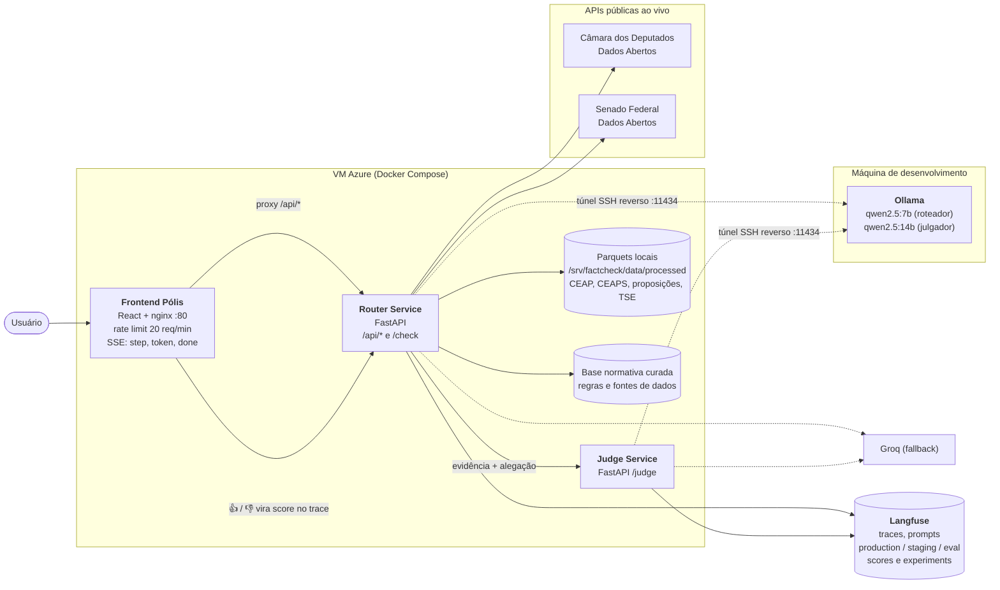
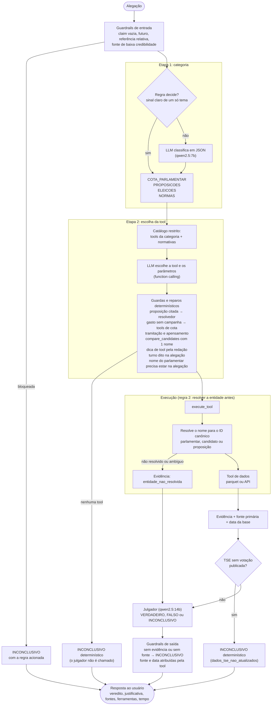
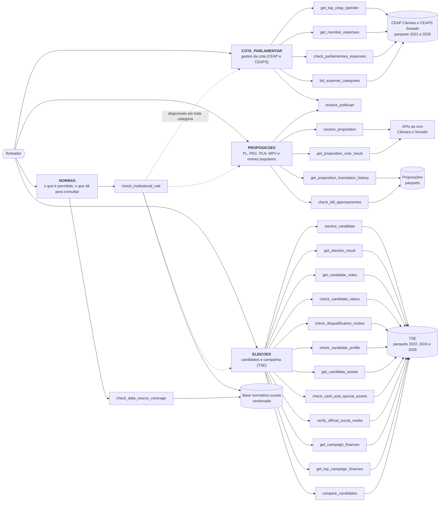

# Arquitetura

## 1. Visão geral (da interface à fonte dos dados)

**Estratégia de LLM:** por padrão a cadeia de provedores é percorrida em ordem (Ollama, Groq, DeepSeek). Com `LLM_STRATEGY=round_robin`, cada requisição começa num provedor diferente (Ollama, Groq, DeepSeek, Ollama, ...) e, se o da vez falhar (fora do ar, limite acabou, disjuntor aberto ou teto diário), passa ao próximo da rotação. Cada chamada ao LLM é registrada no Langfuse com `model`, `provider`, `strategy` e `fallback`; o trace recebe a tag `llm_strategy:<estratégia>`.

**Deploy:** GitHub Actions faz o build das imagens (GHCR) a cada PR; depois do merge na `main`, o CD entra na VM por SSH (com aprovação do revisor), sobe a nova versão, confere `/api/health` e volta à versão anterior se falhar.

## 2. O caminho de uma alegação no roteador

## 3. Tools por categoria

**Regras da constituição que o desenho garante:** nenhum veredito sem evidência de uma tool com fonte primária (regra 1); a entidade é resolvida para o ID antes de qualquer consulta de dado (regra 2); claim subespecificada vira INCONCLUSIVO, sem parâmetro inventado (regra 3); dado transacional e regra institucional ficam em tools separadas (regra 4).
